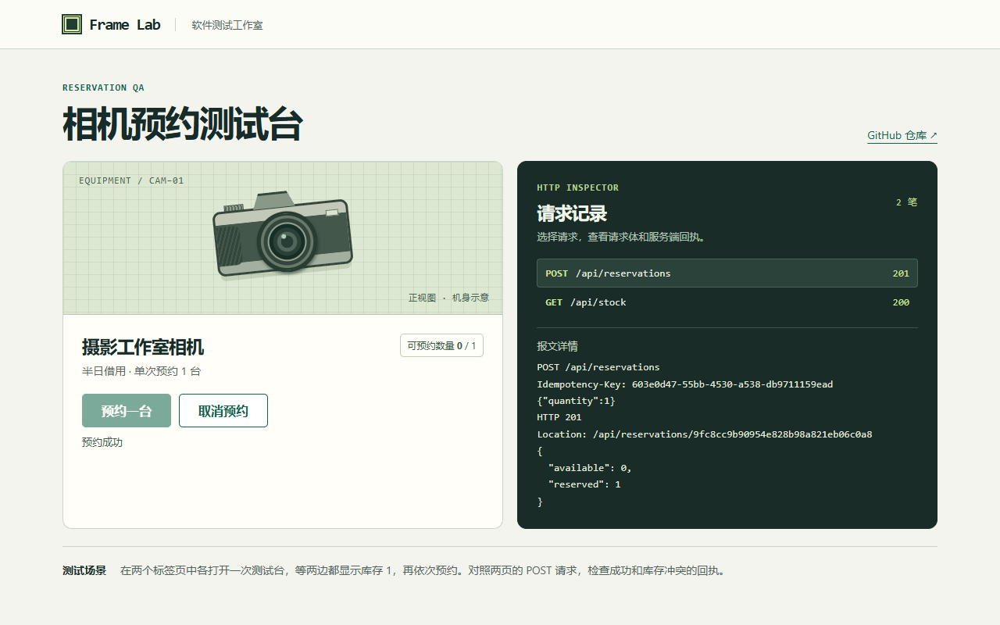

# 相机预约系统测试实战

摄影工作室只剩一台相机。两位用户争抢时只能成功一笔。同一用户因网络中断重复提交时，应能找回原预约。Flask 提供页面和 HTTP 接口，SQLite 保存预约记录。每个测试使用独立数据库，HTTP 测试在随机本地端口运行。



## 前端演示

按下方“运行”安装依赖后，执行 `.\.venv\Scripts\python app.py`，打开 http://127.0.0.1:5050 。在两个标签页同时看到库存 1 后依次预约，比较两边请求记录中的 201 和 409。点击任意请求可看详细报文；回到预约成功的标签页，点击“取消预约”可释放库存。请求面板记录当前页面执行的业务 API 调用，刷新后重新记录。

## 测试策略与实测结果

**一次取消请求返回 404，库存就一定没变吗？** 一种容易漏掉的回归是：A 预约了最后一台相机，取消不存在的 B 时，接口仍返回约定的 404，数据库却把 A 也取消了。客户端若只检查返回码，这条测试会通过。这里先查库存应仍为 0，再查 A 应仍为有效预约。

| 优先验证的风险 | 测试方法 | 可复核的证据 |
| --- | --- | --- |
| 取消或重试影响另一笔预约 | 用独立业务模型算出预期结果，每步查两笔预约及库存 | [状态模型与断言](tests/test_state_model.py) |
| 已扣库存，用户没收到回执 | 把浏览器请求送到真实服务，再丢弃第一次响应；刷新重试后直接查数据库 | [两次服务端回执](reports/recovery.json) · [修复前失败记录](reports/before-fix.xml) |
| 最后一台被超卖，同一笔预约被重复创建 | 同时放行 8 个 HTTP 请求，分别比较不同预约和同键重试的结果 | [库存竞争](tests/test_api.py) · [并发重试](tests/test_lifecycle.py) |

### 用故意改错的代码验证测试能力

每轮在独立临时副本里只改一处服务逻辑，执行同一组测试。未改动的对照组先全部通过。表中数字是触发断言失败的用例数；一次故障只计一次检出。

| 注入的故障 | 原有 12 项接口与生命周期测试 | 新增 8 项状态测试 |
| --- | ---: | ---: |
| 最后一台也拒绝预约 | 4 | 8 |
| 重试返回“新建成功”状态码 | 3 | 7 |
| 取消一笔时误取消其他有效预约 | 0 | 4 |
| 取消不存在的预约却报告成功 | 0 | 5 |

针对这四种人为构造的回归，原测试检出 **2/4**，两组合用检出 **4/4**。完整回归另含浏览器抓包、断线恢复和混合负载测试。[逐项实验结果](reports/mutations.json) · [故障注入脚本](tools/check_mutations.py)

模型范围是 1 台相机、A/B 两个预约键和串行操作。每个键有“未创建、有效、已取消”三种状态，同时有效不可能发生，共有 8 个可达组合。测试用最短操作序列到达每个组合，再分别预约 A、取消 A、预约 B、取消 B，验证 **32 个状态与操作组合**。并发行为由单独的 HTTP 测试验证。

安装依赖后，在项目根目录可独立复跑这两项检查。

```powershell
.\.venv\Scripts\python -m pytest -q tests/test_state_model.py
.\.venv\Scripts\python tools/check_mutations.py
```

## 缺陷复盘：扣了库存，页面没收到回执

旧版中，用 Playwright 把浏览器的预约请求转发到真实服务，收到 201 后丢弃响应。服务端已经扣掉最后一台相机，页面状态栏却一直为空，按钮也无法继续操作。[首次执行的失败报告](reports/before-fix.xml) 和 [第一次提交的服务端回执](reports/before-fix.json) 保留了复现结果。

修复后，页面在当前标签页保存这次提交的幂等键。断线时用户可以刷新并重试。服务端用一个 SQLite 写事务完成查重和预约，重试返回原始回执。测试逐一核对页面提示、库存查询、两次提交的回执地址，以及数据库中唯一的有效预约。[故障注入测试](tests/test_recovery.py) · [修复后的两笔请求记录](reports/recovery.json)

从项目目录运行以下命令可以逐步查看浏览器动作和网络事件。对比原始服务端回执与浏览器看到的失败即可定位响应丢失的位置。

```powershell
.\.venv\Scripts\python -m playwright show-trace reports/before-fix-trace.zip
.\.venv\Scripts\python -m playwright show-trace reports/recovery-trace.zip
```

## 运行

只看结果时，解压后直接用浏览器打开 `reports/load.html`。在 Edge 或 Chrome 的开发者工具 Network 面板中导入 `reports/reservation.har` 可以查看预约请求。

重新跑测试需要 Windows、Python 3.13 和 Microsoft Edge。在解压后的项目目录打开 PowerShell，首次安装依赖需要联网。

```powershell
py -3.13 -m venv .venv
.\.venv\Scripts\python -m pip install -r requirements.txt
.\.venv\Scripts\python -m pytest -q --junitxml=reports/results.xml
```

手动演示时运行 `.\.venv\Scripts\python app.py`，在两个标签页打开 http://127.0.0.1:5050 ，等两页都显示库存 1，再依次预约。手动服务将数据保存在 instance/reservations.sqlite3，重启后保留预约。要释放库存，在开发者工具中复制成功响应的 Location，用 `curl.exe -X DELETE http://127.0.0.1:5050/api/reservations/<预约ID>` 取消对应预约。

## 测试设计

| 要回答的问题 | 工具与入口 | 判定依据 |
| --- | --- | --- |
| 参数非法会不会扣库存？ | pytest 参数化 + Requests，tests/test_api.py | 缺失、零、负数、布尔、字符串、小数、数组均返回 400，复查库存仍为 1 |
| 申请两台能否部分扣减？ | Requests，tests/test_api.py | 返回 409 和可用数量 1，独立查询确认库存仍为 1 |
| 八个请求争抢最后一台会不会超卖？ | 线程屏障同时放行八个 HTTP 客户端任务 | 恰好一个 201、七个 409，最终库存为 0 |
| 页面显示的可用数量过期怎么办？ | Playwright 驱动 Edge，tests/test_browser.py | 两页初始各看到一台，先后提交看到成功和库存不足，两页提交后分别显示 0 并禁用按钮 |
| 浏览器实际发了什么？ | Playwright HAR 录制与 JSON 断言 | 核对方法、路径、状态、请求体和响应体 |
| 同一次预约被并发重发八次怎么办？ | 线程屏障 + Requests，tests/test_lifecycle.py | 一个 201、七个 200，八份回执指向同一预约 |
| 取消、再次借出、旧请求迟到会不会互相干扰？ | HTTP 生命周期测试 | 重复取消只归还一台；旧键重放返回旧回执；新预约仍有效。相同键改数量返回 409 |
| 服务重新创建还能识别旧请求吗？ | 两个 Flask 应用实例依次打开同一个 SQLite 文件 | 第二个实例可取回第一个实例创建的预约，库存仍为 0 |
| 混合读写时服务是否稳定？ | Locust，locustfile.py 与 tests/test_load.py | 5 个虚拟用户持续 10 秒，按 3∶1 权重选择查询或预约后取消；至少 50 次请求、5 次取消、零非预期失败，整体 P95 ≤ 250 ms。库存为零的正常冲突计为预期结果 |

可单独运行 `.\.venv\Scripts\python -m pytest -q tests/test_browser.py` 复现抓包，或把文件名换成 test_api.py、test_load.py 运行对应测试。

## 抓包复盘

在 Edge 或 Chrome 开发者工具的 Network 面板导入 `reports/reservation.har`。这是浏览器记录的 HTTP 层流量，采集范围限定为本次本地服务的 /api/ 路由。按时间顺序检查四笔记录。

| 顺序 | 请求 | 响应 | 含义 |
| --- | --- | --- | --- |
| 1、2 | GET /api/stock | 200，available 为 1 | 两个页面读取了同一初始库存 |
| 3 | POST /api/reservations，quantity 为 1 | 201，reserved 为 1，available 为 0 | 第一笔预约成功 |
| 4 | POST /api/reservations，quantity 为 1 | 409，error 为 insufficient_stock，available 为 0 | 第二个页面持有旧库存，服务端检测到冲突 |

排查“按钮可点但预约失败”时，先比较后两笔请求的 Payload，再比较 Response。相同的 quantity 排除了两次输入不同，409 的业务错误码与第一笔响应中的剩余库存共同解释了失败原因。该用例同时检查用户能看到失败提示，避免只验证接口而漏掉页面误报成功。

## 执行记录

本次完整回归 24 项通过。混合负载共产生 273 次请求，其中库存查询 148 次、预约提交 63 次、取消 62 次。零非预期失败，整体 P95 为 8 ms，预约提交 P95 为 13 ms。250 ms 是本项目设置的回归阈值。数据来自本机开发服务器和 SQLite 的 10 秒冒烟测试。

- `reports/results.xml` 保存逐项测试结果。
- `reports/reservation.har` 保存浏览器请求与响应原文。
- `reports/load.html` 可直接打开查看性能报告，`reports/load_stats.csv` 保存统计数据。

## GitHub 参考

- Cypress Real World App（约 5.9k 星）的支付用例从页面核对付款结果，并直接查询收款人余额。这里采用相同的交叉验证思路，为断线重试同时设置页面、HTTP 和数据库断言。[支付测试源码](https://github.com/cypress-io/cypress-realworld-app/blob/develop/cypress/tests/ui/new-transaction.spec.ts)
- Microsoft Playwright（约 10.1 万星）的测试覆盖请求拦截与响应处理。这里把首次请求发到真实服务，取得回执后对浏览器模拟连接重置，以便稳定复现已提交但结果未知的状态。[网络拦截测试源码](https://github.com/microsoft/playwright/blob/main/tests/page/page-request-intercept.spec.ts)

- 参考 Playwright Python 官方项目的同步浏览器驱动示例，在本项目中扩展为双页面业务断言。[microsoft/playwright-python](https://github.com/microsoft/playwright-python#example)
- 参考 Locust 官方项目的 HttpUser、task 和等待时间示例，在本项目中加入响应内容校验和退出阈值。[locustio/locust](https://github.com/locustio/locust#features)
- HAR 的录制范围、响应体保存和关闭上下文写盘依据 Playwright 的浏览器上下文接口。[Playwright Browser API](https://playwright.dev/python/docs/api/class-browser#browser-new-context-option-record-har-path)
